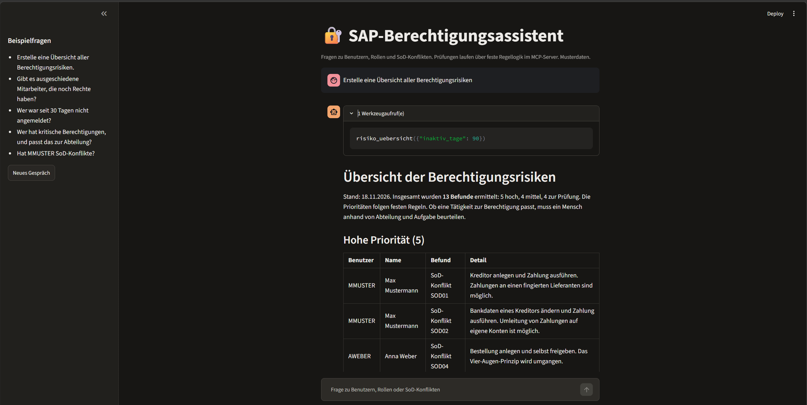
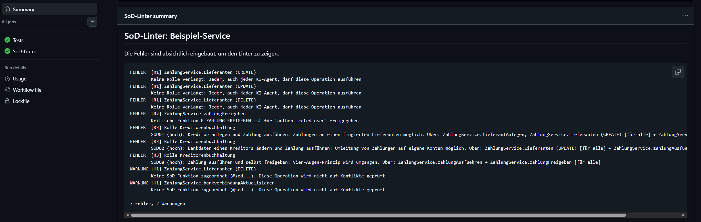
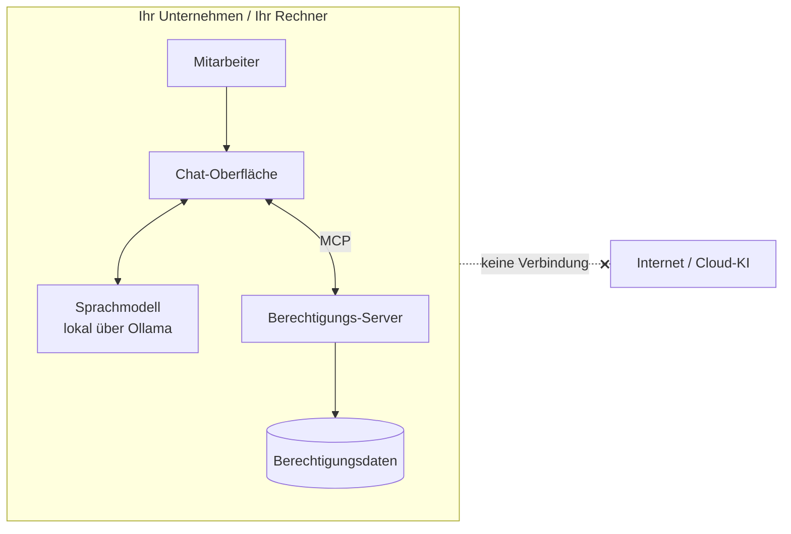
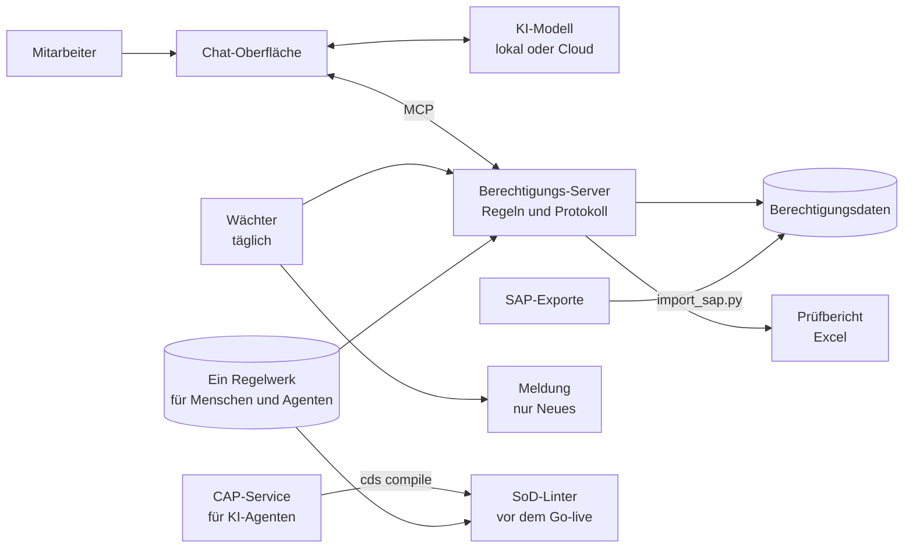

<div align="center">

# SAP-Berechtigungsassistent

### Finden, erklären, lösen. Der Mensch gibt nur noch frei.

**Ein KI-Assistent für SAP-Berechtigungen, der Risiken täglich selbst aufspürt und die Lösung gleich mitliefert.<br>Befunde liefert feste Regellogik, jeder Zugriff wird protokolliert.**

**Neu in v0.5.0:** Ein SoD-Linter prüft CAP-Services für KI-Agenten, **bevor** sie live gehen. Ein Regelwerk für Menschen und Agenten.

🔒 **Läuft vollständig lokal: ohne Cloud, ohne externe API, ohne dass Daten das Unternehmen verlassen.**

[](https://github.com/oemer-systems/sap-auth-mcp/actions/workflows/pruefung.yml)


[Lokal](#-vollständig-lokal-keine-daten-verlassen-ihr-unternehmen) · [Problem](#das-problem) · [Lösung](#die-lösung) · [Wächter](#der-wächter-prüft-täglich-meldet-nur-neues) · [SoD-Linter](#sod-linter-ki-agenten-absichern-bevor-sie-live-gehen) · [Mehrwert](#mehrwert-für-ihr-unternehmen) · [Sicherheit](#sicher-by-design) · [Demo](#demo) · [Einführung](#so-läuft-eine-einführung) · [Fahrplan](#vom-prototyp-zum-einsatz)

</div>

---



> [!IMPORTANT]
> **Ihre Berechtigungsdaten verlassen Ihr Unternehmen nicht.** Im lokalen Modus läuft das Sprachmodell auf eigener Hardware. Keine Cloud, keine externe KI-API, kein API-Key, keine Internetverbindung im Betrieb. [Mehr dazu](#-vollständig-lokal-keine-daten-verlassen-ihr-unternehmen)

## Das Problem

- **Berechtigungsprüfungen sind Handarbeit.** Für jede Revision werden Listen aus mehreren Berichten gezogen, in Excel kombiniert und einzeln erklärt.
- **Fachbereiche verstehen SAP-Berechtigungen nicht.** "Warum kann ich keinen Zahllauf starten?" wird zum Ticket an das Berechtigungsteam.
- **Altlasten bleiben unentdeckt.** Ausgeschiedene Mitarbeiter mit aktivem Konto, Abteilungswechsler mit alten Rollen, abgelaufene Ausnahmegenehmigungen.
- **Geprüft wird selten, gelöst wird von Hand.** Risiken fallen oft erst bei der Revision auf, und für jeden Befund muss jemand die passende Bereinigung ausarbeiten.
- **KI-Assistenten kommen, die Kontrolle fehlt.** Was sieht die KI, woher stammen ihre Aussagen, wohin fließen die Daten?
- **Berechtigungsdaten sind hochsensibel.** Wer was darf, ist für Angreifer wertvoll. Solche Daten an einen externen KI-Dienst zu schicken, ist für viele Unternehmen ausgeschlossen.

## Die Lösung

Ein Assistent, den jeder in normaler Sprache fragen kann. Er greift über eine kontrollierte Schnittstelle auf die Berechtigungsdaten zu, prüft mit festen Regeln und erklärt das Ergebnis verständlich. Das Sprachmodell läuft **vollständig auf eigener Hardware**, ohne dass Daten nach außen gehen. Wer möchte, kann alternativ ein Cloud-Modell nutzen.

| Heute | Mit dem Assistenten |
| --- | --- |
| Listen aus mehreren Berichten in Excel zusammenführen | Eine Frage liefert den priorisierten Prüfbericht |
| Risiken fallen erst bei der Revision auf | Der Wächter prüft täglich und meldet nur, was neu ist |
| Bereinigung von Hand ausarbeiten und hoffen, dass nichts fehlt | Lösungsvorschlag mit Simulation: Was löst der Entzug, was geht verloren? |
| Austritte und Abteilungswechsel mit der Personalabteilung abgleichen | Automatischer Abgleich mit den HR-Daten |
| Ticket schreiben und auf Antwort warten | Frage stellen, Antwort in Sekunden |
| Technische Antwort, die der Fachbereich nicht versteht | Verständliche Erklärung mit Lösungsvorschlag |
| Prüfbericht von Hand für die Akte erstellen | Excel-Bericht auf Knopfdruck |
| Kein Nachweis, wer was gefragt hat | Jeder Zugriff wird protokolliert |
| KI-Agenten bekommen über CAP und `@mcp` Zugriff, ohne SoD-Prüfung | Der SoD-Linter prüft jeden Agenten-Service vor dem Go-live |

## Was er kann

| | Funktion | Beispiel |
| --- | --- | --- |
| 📊 | **Risikoübersicht** über alle Benutzer, nach Priorität sortiert | "Erstelle eine Übersicht aller Berechtigungsrisiken." |
| ⚖️ | **SoD-Prüfung mit Funktionen**, inklusive S/4HANA-Transaktionen wie BP | "Hat KBAUER SoD-Konflikte?" |
| ✅ | **Genehmigte Ausnahmen** mit Kontrolle und Ablaufdatum | "Ist der Konflikt von LKRAUSE ein Problem?" |
| 🛡️ | **Wächter** prüft täglich von selbst und meldet nur neue und erledigte Befunde | `python waechter.py` |
| 💡 | **Lösungsvorschläge** mit fester Logik: Welche Rolle sollte weg, ohne die Abteilung zu behindern? | "Wie löse ich die SoD-Konflikte von MMUSTER am besten?" |
| 🧪 | **Simulation** eines Rollenentzugs, bevor etwas geändert wird | "Was passiert, wenn MMUSTER Z_FI_ZAHLLAUF verliert?" |
| 🚪 | **Austritte und Wechsel** im Abgleich mit den HR-Daten | "Gibt es ausgeschiedene Mitarbeiter, die noch Rechte haben?" |
| 🗂️ | **Rollenkonzept**: Rollen, die nicht zur Abteilung passen | "Wer hat Rollen außerhalb des Rollenkonzepts?" |
| 💤 | **Inaktive Benutzer** mit einstellbarer Schwelle | "Wer war seit 30 Tagen nicht angemeldet?" |
| 🔑 | **Kritische Berechtigungen** wie Benutzer-, Rollen- und Tabellenpflege | "Wer hat kritische Berechtigungen, und passt das zur Abteilung?" |
| 📥 | **Import von SAP-Standardexporten** inklusive HR-Infotypen | `python import_sap.py` |
| 📄 | **Prüfbericht als Excel** für die Prüfungsakte | `python bericht.py` |
| 🔒 | **Vollständig lokaler Betrieb** ohne Cloud, ohne API, ohne Datenabfluss | Auswahl "Lokal" oder `python chat.py lokal` |
| 🤖 | **SoD-Linter** für CAP-Services mit KI-Agenten, vor dem Deployment | `python linter/sod_linter.py csn.json xs-security.json` |
| 🏷️ | **KI-Zuordnung**: Lokales Modell schlägt fehlende SoD-Funktionen vor, ein Mensch bestätigt | `--vorschlagen` |

## Mehrwert für Ihr Unternehmen

| Für | Nutzen |
| --- | --- |
| **Berechtigungsteam** | Tägliche Meldung statt jährlicher Suche, fertige Lösungsvorschläge, weniger Routineanfragen |
| **Revision und Compliance** | Befunde nach festen Regeln, genehmigte Ausnahmen mit Ablaufdatum, Bericht für die Akte, jeder Zugriff nachvollziehbar |
| **Fachbereiche** | Sofortige, verständliche Auskunft statt Wartezeit |
| **IT-Security und Datenschutz** | Kein Datenabfluss nach außen, kein externer KI-Dienst, nur lesende Werkzeuge |
| **Entwicklung auf SAP BTP** | SoD-Fehler in Agenten-Services fallen beim Push auf, nicht erst bei der Revision |

## Sicher by Design

- **Kein freier Datenzugriff:** Die KI nutzt nur freigegebene Werkzeuge
- **Nur lesend:** Nichts wird geändert, keine Berechtigung vergeben
- **Regeln statt Vermutungen:** Befunde und Prioritäten berechnet fester Code. Gleiche Daten, gleiches Ergebnis
- **Mensch entscheidet:** Wächter und KI finden und schlagen vor, Freigaben bleiben beim Menschen
- **Simulation statt Ausführung:** Ein Rollenentzug wird durchgerechnet, nie ausgeführt
- **Lückenlos protokolliert:** Jeder Werkzeugaufruf mit Zeit und Eingabe, unabhängig davon, was die KI über sich selbst sagt
- **Datensparsam:** Die KI erhält nur die Ergebnisse der Prüfungen, nie den gesamten Berechtigungsbestand
- **Vollständig lokal:** Mit dem lokalen Sprachmodell verlässt kein Zeichen den Rechner. Kein API-Key, kein Internet im Betrieb
- **Automatisch getestet:** 28 Tests sichern Prüfungen, Simulation, Wächter und Import ab

**Feste Prioritätsregeln**

| Befund | Priorität |
| --- | --- |
| SoD-Konflikt ohne Ausnahme | Wie im Regelwerk hinterlegt (hoch oder mittel) |
| SoD-Konflikt mit abgelaufener Ausnahme | Hoch: Die genehmigte Kontrolle ist nicht mehr nachgewiesen |
| SoD-Konflikt mit gültiger Ausnahme | Kein Befund, wird als abgesichert aufgeführt |
| Gesperrter Benutzer mit Rollen | Hoch: Eine Entsperrung gibt sofort alle Rechte zurück |
| Ausgetreten, Benutzer aktiv | Hoch: Zugang ohne Arbeitsverhältnis |
| Abteilungswechsel ohne Bereinigung | Mittel: alte Rechte bleiben über den Wechsel hinaus |
| Inaktiver Benutzer mit Rollen | Mittel: ungenutztes Konto als Angriffsfläche |
| Kritische Berechtigung | Prüfen: kann zur Tätigkeit passen, ein Mensch beurteilt |
| Rolle außerhalb des Rollenkonzepts | Prüfen: kann begründet sein, ein Mensch beurteilt |
| Ausnahme läuft in 30 Tagen ab | Prüfen: Verlängerung oder Bereinigung rechtzeitig planen |

## Der Wächter: prüft täglich, meldet nur Neues

Der Wächter läuft ohne Chat und ohne dass jemand fragen muss, zum Beispiel jeden Morgen über die Windows-Aufgabenplanung. Er führt alle Prüfungen aus, vergleicht mit dem letzten Lauf und meldet nur Änderungen. Neue SoD-Konflikte bekommen den passenden Lösungsvorschlag gleich mit, und das lokale Sprachmodell fasst das Ergebnis in wenigen Sätzen zusammen.


*Ein einziger Rollenentzug erledigt fünf Befunde. Der Wächter erkennt das beim nächsten Lauf von selbst.*

| Schritt | Wer |
| --- | --- |
| Risiken finden | Wächter, automatisch |
| Lösung vorschlagen und durchrechnen | Wächter, mit fester Logik |
| Ergebnis verständlich zusammenfassen | Lokales Sprachmodell |
| **Freigeben und umsetzen** | **Mensch** |

## SoD-Linter: KI-Agenten absichern, bevor sie live gehen

Mit einer einzigen Annotation (`@mcp`) wird ein CAP-Service auf SAP BTP für KI-Agenten geöffnet. CAP und XSUAA prüfen dann, ob jemand **eine** Operation ausführen darf. Ob eine Rolle **zwei** Operationen bekommt, die sich beißen, prüfen sie nicht. GRC und IAG prüfen das erst, wenn Rollen schon zugewiesen sind. Der SoD-Linter schließt diese Lücke: Er liest das kompilierte Modell und die `xs-security.json` und findet Konflikte **vor dem Deployment**, ohne etwas zu starten.


| Regel | Findet |
| --- | --- |
| **R1** | Schreibende Operation in einem Agenten-Service ohne Rolle |
| **R2** | Kritische Funktion für `authenticated-user` oder `any` freigegeben |
| **R3** | SoD-Konflikt innerhalb einer Rolle, auch über Rechte, die **jeder** hat |
| **R4** | SoD-Konflikt, der erst durch eine Rollenvorlage in der `xs-security.json` entsteht |
| **H1, H2** | Operationen ohne SoD-Funktion oder mit unbekannter Funktion: Sie werden nicht geprüft und deshalb gemeldet |

**Ein Regelwerk für Menschen und Agenten.** Der Linter nutzt dieselben Funktionen und SoD-Regeln wie der Assistent für SAP-Benutzer. Entwickler ordnen Operationen per `@sod.funktion: 'F_ZAHLUNG'` einer Funktion zu, das Berechtigungsteam pflegt die Regeln an einer Stelle.

**Die KI darf Alarm schlagen, aber nie Entwarnung geben.** Fehlt eine Zuordnung, schlägt ein lokales Sprachmodell die passende Funktion vor. Es kann nur aus dem Regelwerk wählen, Beschreibungen im Code gelten als nicht vertrauenswürdig, und bis ein Mensch den Vorschlag übernimmt, bleibt die Operation als ungeprüft gemeldet.


**Automatisch bei jedem Push.** Eine GitHub Action führt alle Tests und den Linter aus.



<details>
<summary><b>Den Linter im eigenen CAP-Projekt einsetzen</b></summary>

```powershell
cds compile srv --to json --docs | Out-File -Encoding utf8 csn.json
cds compile srv --to xsuaa | Out-File -Encoding utf8 xs-security.json
python linter/sod_linter.py csn.json xs-security.json                 # Regelwerk aus data/
python linter/sod_linter.py csn.json xs-security.json --regeln eigene_regeln.yaml
```

Der Rückgabewert ist `1`, sobald ein Fehler gefunden wird. In einer CI-Pipeline stoppt der Linter damit jedes Deployment mit SoD-Konflikt.

</details>

## 🔒 Vollständig lokal: keine Daten verlassen Ihr Unternehmen

Im lokalen Modus läuft **alles** auf eigener Hardware: die Daten, die Prüfungen, das Protokoll **und das Sprachmodell selbst**. Es wird kein Cloud-Dienst und keine externe KI-API angesprochen.



| | Lokaler Modus |
| --- | --- |
| **Sprachmodell** | Läuft auf der eigenen Grafikkarte (qwen3:8b über Ollama, getestet mit RTX 3080) |
| **Externe KI-API** | Wird nicht verwendet |
| **API-Key, Anmeldung bei einem KI-Anbieter** | Nicht nötig |
| **Internetverbindung im Betrieb** | Nicht nötig, nachgewiesen mit ausgeschaltetem WLAN |
| **Berechtigungsdaten, Fragen, Antworten, Protokoll** | Bleiben vollständig auf dem Rechner |
| **Kosten pro Anfrage** | Keine |
| **Befunde** | Identisch mit dem Cloud-Modus, weil die Prüflogik im Server liegt |

Einmalig bei der Einrichtung werden die Software und das Sprachmodell heruntergeladen. Danach läuft der Assistent ohne Verbindung nach außen. Im Unternehmen kann das Modell statt auf einem einzelnen Rechner auch auf einem eigenen Server laufen.

**Optional: Cloud-Modus.** Für Demos mit Musterdaten oder wenn präzisere Formulierungen wichtig sind, lässt sich alternativ Claude nutzen. Dann gehen Fragen und Prüfergebnisse an die Claude API. Für echte Unternehmensdaten ist der lokale Modus vorgesehen.

| | Lokal (qwen3:8b) | Cloud (Claude) |
| --- | --- | --- |
| **Daten verlassen den Rechner** | Nein | Ja, an die Claude API |
| **Befunde** | Identisch | Identisch |
| **Formulierung und Empfehlungen** | Gut, bei komplexen Fragen einfacher | Sehr präzise |
| **Voraussetzung** | Grafikkarte | API-Key und Internet |

## Demo

**Vollständig offline:** Antwort des lokalen Modells bei ausgeschaltetem WLAN. Kein Cloud-Dienst, keine API, die Berechtigungsdaten bleiben auf dem Rechner.


**Verstoß oder Hinweis?** Kritische Berechtigungen sind nicht automatisch falsch. Der Assistent unterscheidet zwischen Rechten, die zur Abteilung passen, und solchen, die geprüft werden sollten:


**Prüfbericht für die Akte:** [Beispiel-Prüfbericht herunterladen](assets/Beispiel_Pruefbericht.xlsx) mit Zusammenfassung, allen Befunden, Spalten für Maßnahmen und den genehmigten Ausnahmen.

**Offener Standard:** Der Assistent nutzt das Model Context Protocol (MCP). Dieselben Werkzeuge funktionieren in der eigenen Oberfläche, in Claude Desktop und in anderen MCP-fähigen Agenten.


## So funktioniert es



Die KI formuliert, der Berechtigungs-Server prüft. Die Daten kommen aus Standardexporten des SAP-Systems. Der Linter prüft Agenten-Services mit demselben Regelwerk.

## So läuft eine Einführung

**Kein Zugriff auf Ihr SAP-System nötig.** Sie liefern Standardexporte, der Assistent läuft auf einem Rechner in Ihrem Haus, die Daten verlassen das Unternehmen nicht.

| Woche | Was passiert | Ihr Aufwand |
| --- | --- | --- |
| **1** | Umfang festlegen (z. B. ein Mandant, Prozess Kreditoren und Zahlungen), Freigabe durch IT-Sicherheit und Datenschutz, Information des Betriebsrats | 2 bis 3 Termine |
| **1** | Rechner im Firmennetz einrichten, lokales Sprachmodell installieren, danach offline | 1 Tag IT |
| **1** | Exporte über SE16N durch Ihr Berechtigungsteam: USR02, USER_ADDR, AGR_USERS, AGR_TCODES, AGR_TEXTS, PA0000, PA0001, PA0105, T527X | 2 Stunden |
| **1 bis 2** | Ihr SoD-Regelwerk, Ihre genehmigten Ausnahmen und Ihr Rollenkonzept werden übernommen, etwa aus GRC oder Excel | 1 bis 3 Tage, gemeinsam |
| **2** | Abgleich der Befunde mit Ihrem bisherigen Prüfwerkzeug, Abweichungen werden geklärt | 1 Tag |
| **2 bis 5** | Alltagsbetrieb: Wächter täglich, Chat für das Berechtigungsteam, Prüfbericht monatlich, wöchentlich neue Exporte | laufend gering |
| **6** | Auswertung und Entscheidung | 1 Termin |

**Was am Ende des Piloten auf dem Tisch liegt**

| Kennzahl | Gemessen als |
| --- | --- |
| **Zeitersparnis** | Dauer der Berechtigungsprüfung vorher und mit dem Assistenten |
| **Gefundene Risiken** | Befunde nach Priorität, davon wie viele bisher unbekannt waren |
| **Fehlalarme** | Befunde, die sich als unbegründet herausgestellt haben |
| **Bereinigung** | Wie viele Lösungsvorschläge übernommen wurden |

**Wenn Sie eigene Anwendungen auf SAP BTP für KI-Agenten bauen**, kommt der SoD-Linter dazu: Er läuft in Ihrer CI-Pipeline und stoppt jedes Deployment mit SoD-Konflikt, mit demselben Regelwerk wie für Ihre Benutzer.

<details>
<summary><b>Was ein Pilot bewusst nicht leistet</b></summary>

- Keine Live-Anbindung: Der Assistent sieht den Stand des letzten Exports
- Geprüft werden Transaktionen und Funktionen, noch nicht Berechtigungsobjekte und Feldwerte wie in GRC
- Sammelrollen werden noch nicht aufgelöst
- Je nach SAP-Release und Spracheinstellung kann der Import an Ihre Exportformate angepasst werden müssen
- Er ersetzt kein GRC oder IAG. Er macht Befunde schneller sichtbar, verständlich und täglich aktuell

</details>

## Vom Prototyp zum Einsatz

| Phase | Inhalt | Stand |
| --- | --- | --- |
| **1. Proof of Concept** | Auskunft, SoD-Prüfung, Protokoll, eigene Oberfläche | ✅ v0.1.0 |
| **1b. Prüfungen** | Risikoübersicht, inaktive und gesperrte Benutzer, kritische Berechtigungen | ✅ v0.2.0 |
| **2. Pilotfähigkeit** | Funktionsbasiertes Regelwerk, genehmigte Ausnahmen, SAP-Import, Excel-Bericht, lokaler Betrieb, automatische Tests | ✅ v0.3.0 |
| **3. Vorausdenken** | Wächter, Lösungsvorschläge, Simulation, HR-Abgleich, Rollenkonzept | ✅ v0.4.0 |
| **4. Agenten absichern** | SoD-Linter für CAP-Services mit KI-Agenten, ein Regelwerk für Menschen und Agenten, KI-Zuordnung, CI mit GitHub Actions | ✅ v0.5.0 |
| **5. Referenz auf SAP BTP** | Abgesicherter CAP-Service mit getrennten Freigeberrollen und Audit-Log, Regel für eigene Freigeberrollen, Kontrollmatrix | Geplant v0.6.0 |

---

<details>
<summary><b>Installation und Bedienung</b></summary>

Voraussetzungen: Python 3.13, Git. Für den Cloud-Modus ein API-Key aus der [Anthropic Console](https://console.anthropic.com), für den lokalen Modus [Ollama](https://ollama.com/download).

```powershell
git clone https://github.com/oemer-systems/sap-auth-mcp.git
cd sap-auth-mcp
py -3.13 -m venv .venv
.venv\Scripts\activate
pip install -r requirements.txt
```

**Cloud-Modus:** `$env:ANTHROPIC_API_KEY="dein-key"`

**Lokaler Modus:** `ollama pull qwen3:8b`

| Nutzung | Befehl |
| --- | --- |
| Chat im Browser (Modus in der Seitenleiste) | `streamlit run app.py` |
| Chat im Terminal, Cloud | `python chat.py` |
| Chat im Terminal, lokal | `python chat.py lokal` |
| SAP-Exporte importieren (aus `data/sap_export`) | `python import_sap.py` |
| Prüfbericht erstellen (in `berichte/`) | `python bericht.py` |
| Wächter einmal ausführen | `python waechter.py` (mit Zusammenfassung: `--ki`) |
| Wächter täglich um 7 Uhr | `schtasks /Create /SC DAILY /ST 07:00 /TN "SAP-Waechter" /TR "C:\Pfad\zu\sap-auth-mcp\waechter.bat"` |
| SoD-Linter auf den Beispiel-Service | `python linter/sod_linter.py beispiel-cap/csn.json beispiel-cap/xs-security.json` |
| Linter mit KI-Vorschlägen (Ollama muss laufen) | dasselbe mit `--vorschlagen` |
| Tests ausführen | `python -m pytest` |
| MCP Inspector (Node.js) | `npx @modelcontextprotocol/inspector python server.py` |

**Claude Desktop:** Eintrag in `claude_desktop_config.json` unter `mcpServers`:

```json
"sap-auth": {
  "command": "C:\\Pfad\\zu\\sap-auth-mcp\\.venv\\Scripts\\python.exe",
  "args": ["C:\\Pfad\\zu\\sap-auth-mcp\\server.py"]
}
```

</details>

<details>
<summary><b>Technik und Aufbau</b></summary>

Python · MCP Python SDK 2.x · Claude API · Ollama · Streamlit · openpyxl · pytest · SAP CAP (CDS) · GitHub Actions

| Werkzeug | Funktion |
| --- | --- |
| `risiko_uebersicht` | Führt alle Prüfungen zusammen, Befunde nach Priorität, abgesicherte Konflikte separat |
| `sod_pruefen` | SoD-Konflikte eines Benutzers mit Status offen, abgesichert oder Ausnahme abgelaufen |
| `gesperrte_mit_rollen` | Gesperrte Benutzer mit verbliebenen Rollen |
| `inaktive_benutzer` | Aktive Benutzer ohne Anmeldung seit X Tagen (Standard 90) |
| `kritische_berechtigungen` | Benutzer mit kritischen Transaktionen, mit Abteilung zur Beurteilung |
| `loesungsvorschlaege` | Simuliert jede Rolle eines Benutzers und empfiehlt den Entzug, der alle offenen Konflikte löst, ohne die Abteilung zu behindern |
| `simuliere_entzug` | Rechnet durch, welche Konflikte ein Rollenentzug löst und welche Transaktionen verloren gehen |
| `austritt_mit_rechten` | Ausgetretene Mitarbeiter laut HR mit aktivem Benutzer oder Rollen |
| `rollen_ausserhalb_rollenkonzept` | Rollen, die nicht zur Abteilung passen, inklusive Wechsel ohne Bereinigung |
| `ablaufende_ausnahmen` | Genehmigte Ausnahmen, die bald ablaufen |
| `benutzer_rollen` | Stammdaten, Rollen und Transaktionen, Suche über Kennung oder Namen |

| Datei | Aufgabe |
| --- | --- |
| `server.py` | MCP-Server mit Werkzeugen, Regellogik und Protokoll |
| `agent.py` | Agenten-Schleife für Cloud (Claude) und lokal (Ollama) |
| `app.py` / `chat.py` | Chat im Browser / im Terminal |
| `import_sap.py` | Übersetzt SAP-Standardexporte in das Datenformat des Servers |
| `bericht.py` | Erstellt den Excel-Prüfbericht, ohne KI |
| `waechter.py` / `waechter.bat` | Prüft alle Benutzer, meldet nur Änderungen, Start per Aufgabenplanung |
| `linter/sod_linter.py` | SoD-Linter für CAP-Services: liest CSN und `xs-security.json`, prüft die Regeln R1 bis R4 |
| `linter/ki_zuordnung.py` | Lokales Modell schlägt fehlende SoD-Funktionen vor, Antwort auf das Regelwerk beschränkt |
| `beispiel-cap/` | CAP-Service mit absichtlich eingebauten Berechtigungsfehlern als Testobjekt |
| `.github/workflows/pruefung.yml` | Tests und Linter bei jedem Push |
| `tests/` | 53 automatische Tests mit festem Prüfdatum, das Sprachmodell wird im Test ersetzt |
| `data/` | Musterdaten und Regelwerk: Funktionen, SoD-Regeln, Transaktionen, Ausnahmen |
| `data/sap_export/` | Musterexporte im Format der SAP-Tabellen |

**Erkenntnisse aus der Entwicklung**

- Echte SoD-Regelwerke arbeiten mit Funktionen statt einzelnen Transaktionen. Sonst bleibt ein Konflikt über einen anderen Weg, etwa BP in S/4HANA, unentdeckt
- Rollenzuordnungen haben Gültigkeitszeiträume. Ohne deren Prüfung entstehen falsche Befunde
- Code, der vom heutigen Datum abhängt, wird im Test mit einem festen Datum geprüft
- Das Sprachmodell ist austauschbar, weil die Prüflogik im Server liegt. Cloud und lokal liefern dieselben Befunde
- Der Selbstauskunft des Modells ist nicht zu trauen. Verlässlich ist das Protokoll der tatsächlichen Aufrufe
- Ein stdio-Server darf nichts auf die Standardausgabe schreiben, deshalb protokolliert er in eine Datei
- Je mehr Denkarbeit im Code steckt, desto zuverlässiger arbeitet auch ein kleines lokales Modell. Musste es Lösungen selbst ableiten, erfand es Rollennamen. Mit fester Lösungslogik erklärt es nur noch
- Werkzeuge lehnen ungültige Eingaben aktiv ab, etwa eine Transaktion statt einer Rolle, und nennen die richtige Alternative
- Fakten für die KI-Zusammenfassung formuliert der Code eindeutig vor. Sonst deutet ein kleines Modell behobene Befunde als bestehend
- Was jeder darf, darf auch jede einzelne Rolle. Eine offene Tabelle macht aus einer harmlosen Rolle einen SoD-Konflikt, der im Code nirgends steht
- Sicherheitsannahmen immer testen: `@readonly` über dem ganzen Service hat in CAP 10 Schreibzugriffe nicht verhindert, an jeder Entität schon
- Ein Antwortformat mit fester Auswahlliste verhindert, dass ein Sprachmodell Funktionen erfindet. Was es nicht ausgeben kann, muss man nicht abfangen

</details>

<details>
<summary><b>Musterdaten und Befunde</b></summary>

| Benutzer | Befund | Priorität |
| --- | --- | --- |
| MMUSTER | Kreditor anlegen und ändern sowie Zahllauf (SOD01, SOD02, SOD03) | hoch / mittel |
| KBAUER | Geschäftspartnerpflege in S/4HANA (BP) und Zahllauf (SOD01, SOD02), Rolle außerhalb des Rollenkonzepts | hoch / prüfen |
| AWEBER | Bestellung selbst freigeben (SOD04), Wareneingang mit abgelaufener Ausnahme (SOD05), seit Oktober im Vertrieb mit alten Einkaufsrollen | hoch / mittel |
| JBECKER | Rollen pflegen und zuweisen (SOD07), Entwicklerrechte | hoch / prüfen |
| NWOLF | Gesperrt, Rollen noch zugeordnet | hoch |
| LKRAUSE | Auftrag und Kreditlimit (SOD06), durch genehmigte Kontrolle abgesichert | kein Befund |
| DSCHULZ | Laut HR seit März 2025 ausgetreten, Benutzer noch aktiv | hoch |
| FIREFIGHTER_01 | Notfallbenutzer mit dauerhaften Entwicklerrechten | prüfen |
| PKLEIN | Abgelaufene Rollenzuordnung, wird beim Import übersprungen | kein Befund |

Die Risikoübersicht liefert 18 Befunde: 9 hoch, 2 mittel, 7 prüfen, dazu 1 abgesicherter Konflikt (Stand November 2026). Lösungsvorschläge: MMUSTER Z_FI_ZAHLLAUF, KBAUER Z_S4_GP_PFLEGE, AWEBER Z_MM_EINKAUF entziehen. Für JBECKER gibt es bewusst keinen Vorschlag, weil beide Rollen zur IT-Basis gehören.

</details>

<details>
<summary><b>Stand und Grenzen</b></summary>

- Frei erfundene Musterdaten, Import aus Exportdateien statt Live-Anbindung
- SoD-Prüfung auf Ebene von Transaktionen und Funktionen, noch nicht auf Ebene von Berechtigungsobjekten und Feldwerten
- Sammelrollen (AGR_AGRS) werden noch nicht aufgelöst
- Protokoll ohne Benutzerbezug, das folgt mit Anmeldung in Phase 4
- Der Wächter meldet in Konsole, Log und Bericht. Benachrichtigung per Mail oder Teams ist noch nicht eingebaut
- Vorschläge werden nie ausgeführt. Das ist Absicht, nicht Grenze
- Der Linter prüft, was im Modell steht. Eine falsche `@sod`-Zuordnung kann er nicht erkennen, die KI kann sie nur als Verdacht melden
- Der Linter ersetzt keine Laufzeitprüfung und kein GRC oder IAG, er ergänzt sie vor dem Deployment
- Die Annotationen `@mcp` und `@agent` des CAP-MCP-Adapters können sich noch ändern
- Nur im optionalen Cloud-Modus gehen Fragen und Werkzeugergebnisse an die Claude API. Im lokalen Modus verlassen keine Daten den Rechner
- Das lokale Modell formuliert bei komplexen Fragen einfacher als große Cloud-Modelle

</details>

---

<div align="center">

**Interesse an einer Vorführung oder einem Pilot mit Ihrem Regelwerk?**

[github.com/oemer-systems](https://github.com/oemer-systems)

<sub>Proof of Concept mit frei erfundenen Musterdaten. Entwickelt mit KI-Unterstützung.</sub>

</div>
