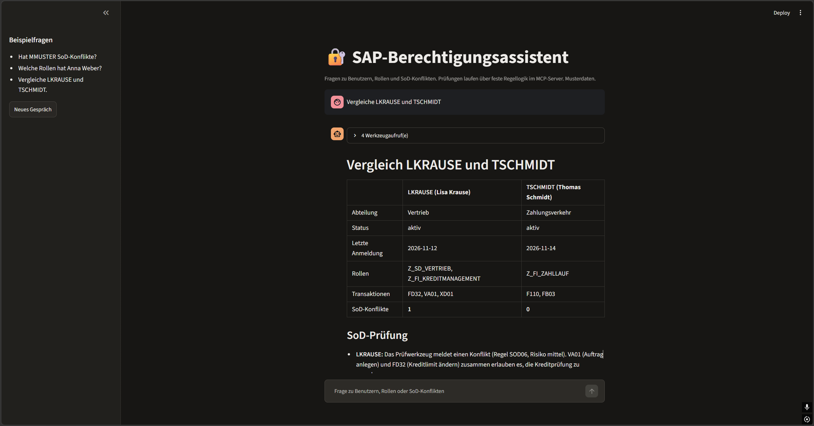
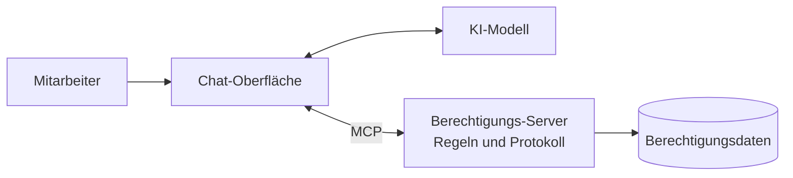

<div align="center">

# SAP-Berechtigungsassistent

### Berechtigungsrisiken in Sekunden erkennen. Ohne Ticket. Mit Beleg.

**Ein KI-Assistent für SAP-Berechtigungen, der erklärt, statt zu raten.<br>Befunde und Prioritäten liefert feste Regellogik, jeder Zugriff wird protokolliert.**


[Problem](#das-problem) · [Lösung](#die-lösung) · [Mehrwert](#mehrwert-für-ihr-unternehmen) · [Sicherheit](#sicher-by-design) · [Demo](#demo) · [Fahrplan](#vom-prototyp-zum-einsatz)

</div>

---


## Das Problem

- **Berechtigungsprüfungen sind Handarbeit.** Für jede Revision werden Listen aus mehreren Berichten gezogen, in Excel kombiniert und einzeln erklärt.
- **Fachbereiche verstehen SAP-Berechtigungen nicht.** "Warum kann ich keinen Zahllauf starten?" wird zum Ticket an das Berechtigungsteam.
- **Altlasten bleiben unentdeckt.** Ausgeschiedene Mitarbeiter mit Rollen, ungenutzte Konten, Notfallbenutzer mit Dauerrechten.
- **KI-Assistenten kommen, die Kontrolle fehlt.** Was sieht die KI, woher stammen ihre Aussagen, wer hat was gefragt?

## Die Lösung

Ein Assistent, den jeder in normaler Sprache fragen kann. Er greift über eine kontrollierte Schnittstelle auf die Berechtigungsdaten zu, prüft mit festen Regeln und erklärt das Ergebnis verständlich.

| Heute | Mit dem Assistenten |
| --- | --- |
| Listen aus mehreren Berichten in Excel zusammenführen | Eine Frage liefert den priorisierten Prüfbericht |
| Ticket schreiben und auf Antwort warten | Frage stellen, Antwort in Sekunden |
| Technische Antwort, die der Fachbereich nicht versteht | Verständliche Erklärung mit Lösungsvorschlag |
| Kein Nachweis, wer was gefragt hat | Jeder Zugriff wird protokolliert |

## Was er kann

| | Prüfung | Beispielfrage |
| --- | --- | --- |
| 📊 | **Risikoübersicht** über alle Benutzer, nach Priorität sortiert | "Erstelle eine Übersicht aller Berechtigungsrisiken." |
| ⚖️ | **SoD-Konflikte** in der Funktionstrennung | "Hat MMUSTER SoD-Konflikte?" |
| 🚪 | **Gesperrte Benutzer mit Rollen**, etwa nach Austritt | "Gibt es ausgeschiedene Mitarbeiter, die noch Rechte haben?" |
| 💤 | **Inaktive Benutzer** mit einstellbarer Schwelle | "Wer war seit 30 Tagen nicht angemeldet?" |
| 🔑 | **Kritische Berechtigungen** wie Benutzer-, Rollen- und Tabellenpflege | "Wer hat kritische Berechtigungen, und passt das zur Abteilung?" |
| 👤 | **Berechtigungsauskunft** zu einzelnen Benutzern | "Vergleiche LKRAUSE und TSCHMIDT." |

## Mehrwert für Ihr Unternehmen

| Für | Nutzen |
| --- | --- |
| **Berechtigungsteam** | Prüfbericht auf Knopfdruck, weniger Routineanfragen, mehr Zeit für Konzept und Risikoarbeit |
| **Revision und Compliance** | Befunde nach festen Regeln, priorisiert, jeder Zugriff nachvollziehbar |
| **Fachbereiche** | Sofortige, verständliche Auskunft statt Wartezeit |
| **IT-Security** | Die KI arbeitet nur über freigegebene, lesende Werkzeuge |

## Sicher by Design

- **Kein freier Datenzugriff:** Die KI nutzt nur freigegebene Werkzeuge
- **Nur lesend:** Nichts wird geändert, keine Berechtigung vergeben
- **Regeln statt Vermutungen:** Befunde und Prioritäten berechnet fester Code. Gleiche Daten, gleiches Ergebnis
- **Mensch entscheidet:** Die KI erklärt und schlägt vor, Freigaben bleiben beim Menschen
- **Lückenlos protokolliert:** Jeder Werkzeugaufruf mit Zeit und Eingabe, unabhängig davon, was die KI über sich selbst sagt
- **Datensparsam:** Die KI erhält nur die Ergebnisse der Prüfungen, nie den gesamten Berechtigungsbestand

**Feste Prioritätsregeln**

| Befund | Priorität |
| --- | --- |
| SoD-Konflikt | Wie im Regelwerk hinterlegt (hoch oder mittel) |
| Gesperrter Benutzer mit Rollen | Hoch: Eine Entsperrung gibt sofort alle Rechte zurück |
| Inaktiver Benutzer mit Rollen | Mittel: ungenutztes Konto als Angriffsfläche |
| Kritische Berechtigung | Prüfen: kann zur Tätigkeit passen, ein Mensch beurteilt |

## Demo

**Verstoß oder Hinweis?** Kritische Berechtigungen sind nicht automatisch falsch. Der Assistent unterscheidet zwischen Rechten, die zur Abteilung passen, etwa der Zahllauf im Zahlungsverkehr, und solchen, die genauer geprüft werden sollten:


**Nachvollziehbar:** Jede Antwort zeigt die zugrunde liegenden Werkzeugaufrufe.



**Offener Standard:** Der Assistent nutzt das Model Context Protocol (MCP). Dieselben Werkzeuge funktionieren in der eigenen Oberfläche, in Claude Desktop und in anderen MCP-fähigen Agenten.


## So funktioniert es



Die KI formuliert, der Berechtigungs-Server prüft. Die Datenquelle ist austauschbar: heute Musterdaten, im Einsatz Ihr SAP-System.

## Vom Prototyp zum Einsatz

| Phase | Inhalt | Stand |
| --- | --- | --- |
| **1. Proof of Concept** | Auskunft, SoD-Prüfung, Protokoll, eigene Oberfläche | ✅ v0.1.0 |
| **1b. Prüfungen** | Risikoübersicht, inaktive und gesperrte Benutzer, kritische Berechtigungen | ✅ v0.2.0 |
| **2. Pilot** | Ihr SoD-Regelwerk und ein Berechtigungsexport aus Ihrem System, genehmigte Ausnahmen berücksichtigen, Bericht als Datei | Nächster Schritt |
| **3. Integration** | Live-Anbindung an SAP, Betrieb auf SAP BTP mit Anmeldung, Protokoll mit Benutzerbezug | Geplant |
| **4. Ausbau** | Einbindung in Joule-Agenten, lokales Sprachmodell, Prüfung auf Ebene von Berechtigungsobjekten | Geplant |

---

<details>
<summary><b>Installation und Bedienung</b></summary>

Voraussetzungen: Python 3.13, Git, API-Key aus der [Anthropic Console](https://console.anthropic.com)

```powershell
git clone https://github.com/oemer-systems/sap-auth-mcp.git
cd sap-auth-mcp
py -3.13 -m venv .venv
.venv\Scripts\activate
pip install -r requirements.txt
$env:ANTHROPIC_API_KEY="dein-key"
```

| Nutzung | Befehl |
| --- | --- |
| Chat im Browser | `streamlit run app.py` |
| Chat im Terminal | `python chat.py` |
| Prüfung direkt, ohne KI | `python -c "from server import risiko_uebersicht; print(risiko_uebersicht())"` |
| MCP Inspector (Node.js) | `npx @modelcontextprotocol/inspector python server.py` |

**Claude Desktop:** Eintrag in `claude_desktop_config.json` unter `mcpServers`:

```json
"sap-auth": {
  "command": "C:\\Pfad\\zu\\sap-auth-mcp\\.venv\\Scripts\\python.exe",
  "args": ["C:\\Pfad\\zu\\sap-auth-mcp\\server.py"]
}
```

</details>

<details>
<summary><b>Technik und Aufbau</b></summary>

Python · MCP Python SDK 2.x · Claude API · Streamlit

| Werkzeug | Funktion |
| --- | --- |
| `risiko_uebersicht` | Führt alle Prüfungen zusammen, Befunde nach Priorität sortiert |
| `sod_pruefen` | SoD-Konflikte eines Benutzers |
| `gesperrte_mit_rollen` | Gesperrte Benutzer mit verbliebenen Rollen |
| `inaktive_benutzer` | Aktive Benutzer ohne Anmeldung seit X Tagen (Standard 90) |
| `kritische_berechtigungen` | Benutzer mit kritischen Transaktionen, mit Abteilung zur Beurteilung |
| `benutzer_rollen` | Stammdaten, Rollen und Transaktionen, Suche über Kennung oder Namen |

| Datei | Aufgabe |
| --- | --- |
| `server.py` | MCP-Server mit Werkzeugen, Regellogik und Protokoll |
| `agent.py` | Agenten-Schleife: Werkzeuge abfragen, Modell befragen, Aufrufe ausführen |
| `app.py` | Chat-Oberfläche im Browser |
| `chat.py` | Chat im Terminal |
| `data/` | Musterdaten: Benutzer, Rollen, Zuordnungen, Transaktionen, SoD-Regeln |

**Erkenntnisse aus der Entwicklung**

- Die Werkzeugbeschreibung steuert die KI: Name und Docstring sind alles, was das Modell über ein Werkzeug erfährt
- Parameter mit Standardwert machen Werkzeuge flexibel: Die KI leitet "seit 30 Tagen" selbst als `tage=30` ab
- Das Modell führt nichts selbst aus. Es fordert einen Werkzeugaufruf an, der eigene Code entscheidet
- Der Selbstauskunft des Modells ist nicht zu trauen. Verlässlich ist das Protokoll der tatsächlichen Aufrufe
- Ein stdio-Server darf nichts auf die Standardausgabe schreiben, deshalb protokolliert er in eine Datei
- Im MCP SDK 2.x heißt `FastMCP` jetzt `MCPServer`, ältere Beispiele müssen angepasst werden

</details>

<details>
<summary><b>Musterdaten und Befunde</b></summary>

| Benutzer | Befund | Priorität |
| --- | --- | --- |
| MMUSTER | Kreditor anlegen und Zahllauf ausführen (SOD01, SOD02, SOD03) | hoch / mittel |
| AWEBER | Bestellung anlegen, selbst freigeben und Wareneingang buchen (SOD04, SOD05) | hoch / mittel |
| JBECKER | Rollen pflegen und zuweisen (SOD07), Entwicklerrechte | hoch / prüfen |
| NWOLF | Gesperrt, Rollen noch zugeordnet | hoch |
| LKRAUSE | Auftrag anlegen und Kreditlimit ändern (SOD06) | mittel |
| DSCHULZ | Seit Februar 2025 inaktiv, Rollen noch zugeordnet | mittel |
| FIREFIGHTER_01 | Notfallbenutzer mit dauerhaften Entwicklerrechten | prüfen |
| MMUSTER, TSCHMIDT | Zahllauf (F110), bei TSCHMIDT passend zur Abteilung | prüfen |

Die Risikoübersicht liefert bei 90 Tagen Schwelle 13 Befunde: 5 hoch, 4 mittel, 4 prüfen (Stand November 2026).

</details>

<details>
<summary><b>Stand des Proof of Concept</b></summary>

- Frei erfundene Musterdaten, noch keine Anbindung an ein SAP-System
- Transaktionscodes nach SAP ECC, in S/4HANA erfolgt die Kreditorenpflege über die Transaktion BP
- SoD-Prüfung auf Transaktionsebene, noch nicht auf Ebene von Berechtigungsobjekten
- Genehmigte Ausnahmen (Mitigationen) werden noch nicht berücksichtigt
- Protokoll ohne Benutzerbezug, das folgt mit Anmeldung in Phase 3
- Fragen und Werkzeugergebnisse gehen an die Claude API

</details>

---

<div align="center">

**Interesse an einer Vorführung oder einem Pilot mit Ihrem Regelwerk?**

[github.com/oemer-systems](https://github.com/oemer-systems)

<sub>Proof of Concept mit frei erfundenen Musterdaten. Entwickelt mit KI-Unterstützung.</sub>

</div>
