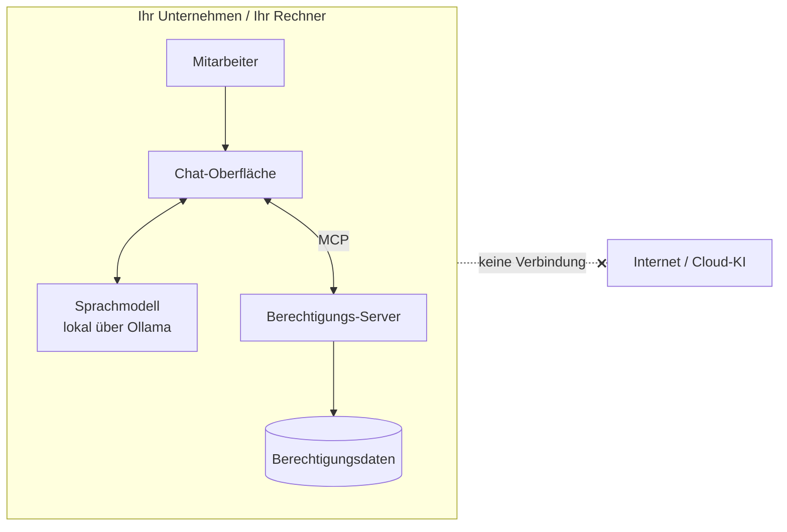
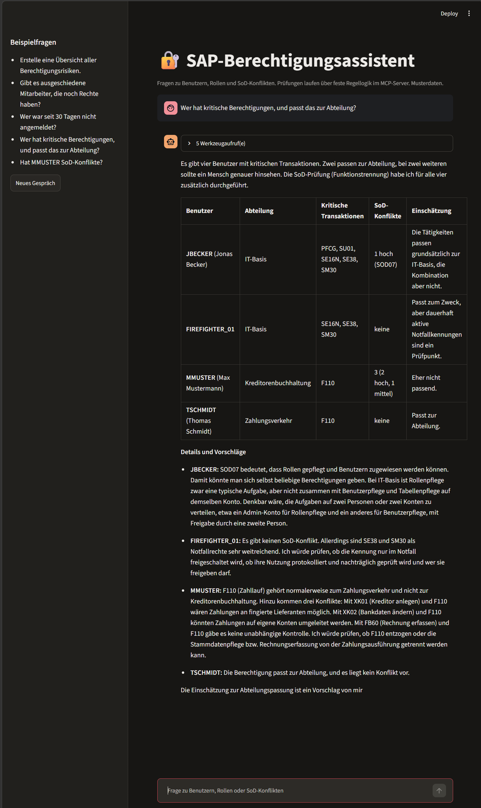
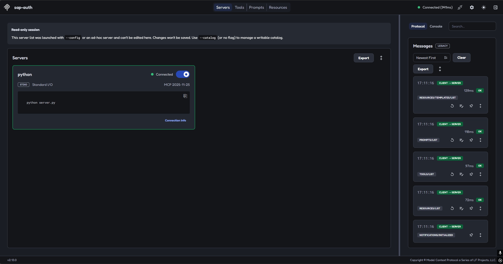
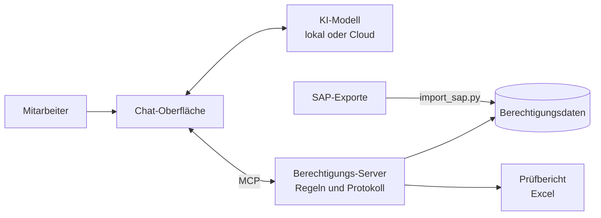

<div align="center">

# SAP-Berechtigungsassistent

### Berechtigungsrisiken in Sekunden erkennen. Ohne Ticket. Mit Beleg.

**Ein KI-Assistent für SAP-Berechtigungen, der erklärt, statt zu raten.<br>Befunde liefert feste Regellogik, jeder Zugriff wird protokolliert.**

🔒 **Läuft vollständig lokal: ohne Cloud, ohne externe API, ohne dass Daten das Unternehmen verlassen.**


[Lokal](#-vollständig-lokal-keine-daten-verlassen-ihr-unternehmen) · [Problem](#das-problem) · [Lösung](#die-lösung) · [Mehrwert](#mehrwert-für-ihr-unternehmen) · [Sicherheit](#sicher-by-design) · [Demo](#demo) · [Pilot](#bereit-für-einen-pilot) · [Fahrplan](#vom-prototyp-zum-einsatz)

</div>

---


> [!IMPORTANT]
> **Ihre Berechtigungsdaten verlassen Ihr Unternehmen nicht.** Im lokalen Modus läuft das Sprachmodell auf eigener Hardware. Keine Cloud, keine externe KI-API, kein API-Key, keine Internetverbindung im Betrieb. [Mehr dazu](#-vollständig-lokal-keine-daten-verlassen-ihr-unternehmen)

## Das Problem

- **Berechtigungsprüfungen sind Handarbeit.** Für jede Revision werden Listen aus mehreren Berichten gezogen, in Excel kombiniert und einzeln erklärt.
- **Fachbereiche verstehen SAP-Berechtigungen nicht.** "Warum kann ich keinen Zahllauf starten?" wird zum Ticket an das Berechtigungsteam.
- **Altlasten bleiben unentdeckt.** Ausgeschiedene Mitarbeiter mit Rollen, ungenutzte Konten, abgelaufene Ausnahmegenehmigungen.
- **KI-Assistenten kommen, die Kontrolle fehlt.** Was sieht die KI, woher stammen ihre Aussagen, wohin fließen die Daten?
- **Berechtigungsdaten sind hochsensibel.** Wer was darf, ist für Angreifer wertvoll. Solche Daten an einen externen KI-Dienst zu schicken, ist für viele Unternehmen ausgeschlossen.

## Die Lösung

Ein Assistent, den jeder in normaler Sprache fragen kann. Er greift über eine kontrollierte Schnittstelle auf die Berechtigungsdaten zu, prüft mit festen Regeln und erklärt das Ergebnis verständlich. Das Sprachmodell läuft **vollständig auf eigener Hardware**, ohne dass Daten nach außen gehen. Wer möchte, kann alternativ ein Cloud-Modell nutzen.

| Heute | Mit dem Assistenten |
| --- | --- |
| Listen aus mehreren Berichten in Excel zusammenführen | Eine Frage liefert den priorisierten Prüfbericht |
| Ticket schreiben und auf Antwort warten | Frage stellen, Antwort in Sekunden |
| Technische Antwort, die der Fachbereich nicht versteht | Verständliche Erklärung mit Lösungsvorschlag |
| Prüfbericht von Hand für die Akte erstellen | Excel-Bericht auf Knopfdruck |
| Kein Nachweis, wer was gefragt hat | Jeder Zugriff wird protokolliert |

## Was er kann

| | Funktion | Beispiel |
| --- | --- | --- |
| 📊 | **Risikoübersicht** über alle Benutzer, nach Priorität sortiert | "Erstelle eine Übersicht aller Berechtigungsrisiken." |
| ⚖️ | **SoD-Prüfung mit Funktionen**, inklusive S/4HANA-Transaktionen wie BP | "Hat KBAUER SoD-Konflikte?" |
| ✅ | **Genehmigte Ausnahmen** mit Kontrolle und Ablaufdatum | "Ist der Konflikt von LKRAUSE ein Problem?" |
| 🚪 | **Gesperrte Benutzer mit Rollen**, etwa nach Austritt | "Gibt es ausgeschiedene Mitarbeiter, die noch Rechte haben?" |
| 💤 | **Inaktive Benutzer** mit einstellbarer Schwelle | "Wer war seit 30 Tagen nicht angemeldet?" |
| 🔑 | **Kritische Berechtigungen** wie Benutzer-, Rollen- und Tabellenpflege | "Wer hat kritische Berechtigungen, und passt das zur Abteilung?" |
| 📥 | **Import von SAP-Standardexporten** (USR02, USER_ADDR, AGR_USERS, AGR_TCODES, AGR_TEXTS) | `python import_sap.py` |
| 📄 | **Prüfbericht als Excel** für die Prüfungsakte | `python bericht.py` |
| 🔒 | **Vollständig lokaler Betrieb** ohne Cloud, ohne API, ohne Datenabfluss | Auswahl "Lokal" oder `python chat.py lokal` |

## Mehrwert für Ihr Unternehmen

| Für | Nutzen |
| --- | --- |
| **Berechtigungsteam** | Prüfbericht auf Knopfdruck, weniger Routineanfragen, mehr Zeit für Konzept und Risikoarbeit |
| **Revision und Compliance** | Befunde nach festen Regeln, genehmigte Ausnahmen mit Ablaufdatum, Bericht für die Akte, jeder Zugriff nachvollziehbar |
| **Fachbereiche** | Sofortige, verständliche Auskunft statt Wartezeit |
| **IT-Security und Datenschutz** | Kein Datenabfluss nach außen, kein externer KI-Dienst, nur lesende Werkzeuge |

## Sicher by Design

- **Kein freier Datenzugriff:** Die KI nutzt nur freigegebene Werkzeuge
- **Nur lesend:** Nichts wird geändert, keine Berechtigung vergeben
- **Regeln statt Vermutungen:** Befunde und Prioritäten berechnet fester Code. Gleiche Daten, gleiches Ergebnis
- **Mensch entscheidet:** Die KI erklärt und schlägt vor, Freigaben bleiben beim Menschen
- **Lückenlos protokolliert:** Jeder Werkzeugaufruf mit Zeit und Eingabe, unabhängig davon, was die KI über sich selbst sagt
- **Datensparsam:** Die KI erhält nur die Ergebnisse der Prüfungen, nie den gesamten Berechtigungsbestand
- **Vollständig lokal:** Mit dem lokalen Sprachmodell verlässt kein Zeichen den Rechner. Kein API-Key, kein Internet im Betrieb
- **Automatisch getestet:** 15 Tests sichern alle Prüfungen und den Import ab

**Feste Prioritätsregeln**

| Befund | Priorität |
| --- | --- |
| SoD-Konflikt ohne Ausnahme | Wie im Regelwerk hinterlegt (hoch oder mittel) |
| SoD-Konflikt mit abgelaufener Ausnahme | Hoch: Die genehmigte Kontrolle ist nicht mehr nachgewiesen |
| SoD-Konflikt mit gültiger Ausnahme | Kein Befund, wird als abgesichert aufgeführt |
| Gesperrter Benutzer mit Rollen | Hoch: Eine Entsperrung gibt sofort alle Rechte zurück |
| Inaktiver Benutzer mit Rollen | Mittel: ungenutztes Konto als Angriffsfläche |
| Kritische Berechtigung | Prüfen: kann zur Tätigkeit passen, ein Mensch beurteilt |

## 🔒 Vollständig lokal: keine Daten verlassen Ihr Unternehmen

Im lokalen Modus läuft **alles** auf eigener Hardware: die Daten, die Prüfungen, das Protokoll **und das Sprachmodell selbst**. Es wird kein Cloud-Dienst und keine externe KI-API angesprochen.



| | Lokaler Modus |
| --- | --- |
| **Sprachmodell** | Läuft auf der eigenen Grafikkarte (qwen3:8b über Ollama, getestet mit RTX 3080) |
| **Externe KI-API** | Wird nicht verwendet |
| **API-Key, Anmeldung bei einem KI-Anbieter** | Nicht nötig |
| **Internetverbindung im Betrieb** | Nicht nötig, nachgewiesen mit ausgeschaltetem WLAN |
| **Berechtigungsdaten, Fragen, Antworten, Protokoll** | Bleiben vollständig auf dem Rechner |
| **Kosten pro Anfrage** | Keine |
| **Befunde** | Identisch mit dem Cloud-Modus, weil die Prüflogik im Server liegt |

Einmalig bei der Einrichtung werden die Software und das Sprachmodell heruntergeladen. Danach läuft der Assistent ohne Verbindung nach außen. Im Unternehmen kann das Modell statt auf einem einzelnen Rechner auch auf einem eigenen Server laufen.

**Optional: Cloud-Modus.** Für Demos mit Musterdaten oder wenn präzisere Formulierungen wichtig sind, lässt sich alternativ Claude nutzen. Dann gehen Fragen und Prüfergebnisse an die Claude API. Für echte Unternehmensdaten ist der lokale Modus vorgesehen.

| | Lokal (qwen3:8b) | Cloud (Claude) |
| --- | --- | --- |
| **Daten verlassen den Rechner** | Nein | Ja, an die Claude API |
| **Befunde** | Identisch | Identisch |
| **Formulierung und Empfehlungen** | Gut, bei komplexen Fragen einfacher | Sehr präzise |
| **Voraussetzung** | Grafikkarte | API-Key und Internet |

## Demo

**Vollständig offline:** Antwort des lokalen Modells bei ausgeschaltetem WLAN. Kein Cloud-Dienst, keine API, die Berechtigungsdaten bleiben auf dem Rechner.


**Verstoß oder Hinweis?** Kritische Berechtigungen sind nicht automatisch falsch. Der Assistent unterscheidet zwischen Rechten, die zur Abteilung passen, und solchen, die geprüft werden sollten:



**Prüfbericht für die Akte:** [Beispiel-Prüfbericht herunterladen](assets/Beispiel_Pruefbericht.xlsx) mit Zusammenfassung, allen Befunden, Spalten für Maßnahmen und den genehmigten Ausnahmen.

**Offener Standard:** Der Assistent nutzt das Model Context Protocol (MCP). Dieselben Werkzeuge funktionieren in der eigenen Oberfläche, in Claude Desktop und in anderen MCP-fähigen Agenten.



## So funktioniert es



Die KI formuliert, der Berechtigungs-Server prüft. Die Daten kommen aus Standardexporten des SAP-Systems.

## Bereit für einen Pilot

Ein Pilot über 4 bis 6 Wochen braucht vom Unternehmen nur drei Dinge:

1. **Exporte** der Tabellen USR02, USER_ADDR, AGR_USERS, AGR_TCODES und AGR_TEXTS, z. B. über SE16N
2. **Das SoD-Regelwerk** mit Funktionen und Regeln
3. **Die genehmigten Ausnahmen** mit Kontrolle und Gültigkeit

Kein Zugriff auf das SAP-System nötig. **Der Pilot läuft vollständig lokal** auf einem Rechner oder Server des Unternehmens, die Daten verlassen das Haus nicht. Im Pilot werden die Befunde mit dem vorhandenen Prüfwerkzeug abgeglichen, bevor der Assistent im Alltag genutzt wird.

## Vom Prototyp zum Einsatz

| Phase | Inhalt | Stand |
| --- | --- | --- |
| **1. Proof of Concept** | Auskunft, SoD-Prüfung, Protokoll, eigene Oberfläche | ✅ v0.1.0 |
| **1b. Prüfungen** | Risikoübersicht, inaktive und gesperrte Benutzer, kritische Berechtigungen | ✅ v0.2.0 |
| **2. Pilotfähigkeit** | Funktionsbasiertes Regelwerk, genehmigte Ausnahmen, SAP-Import, Excel-Bericht, lokaler Betrieb, automatische Tests | ✅ v0.3.0 |
| **3. Integration** | Live-Anbindung an SAP, Betrieb auf SAP BTP mit Anmeldung, Protokoll mit Benutzerbezug | Geplant |
| **4. Ausbau** | Einbindung in Joule-Agenten, Prüfung auf Ebene von Berechtigungsobjekten, Sammelrollen | Geplant |

---

<details>
<summary><b>Installation und Bedienung</b></summary>

Voraussetzungen: Python 3.13, Git. Für den Cloud-Modus ein API-Key aus der [Anthropic Console](https://console.anthropic.com), für den lokalen Modus [Ollama](https://ollama.com/download).

```powershell
git clone https://github.com/oemer-systems/sap-auth-mcp.git
cd sap-auth-mcp
py -3.13 -m venv .venv
.venv\Scripts\activate
pip install -r requirements.txt
```

**Cloud-Modus:** `$env:ANTHROPIC_API_KEY="dein-key"`

**Lokaler Modus:** `ollama pull qwen3:8b`

| Nutzung | Befehl |
| --- | --- |
| Chat im Browser (Modus in der Seitenleiste) | `streamlit run app.py` |
| Chat im Terminal, Cloud | `python chat.py` |
| Chat im Terminal, lokal | `python chat.py lokal` |
| SAP-Exporte importieren (aus `data/sap_export`) | `python import_sap.py` |
| Prüfbericht erstellen (in `berichte/`) | `python bericht.py` |
| Tests ausführen | `python -m pytest` |
| MCP Inspector (Node.js) | `npx @modelcontextprotocol/inspector python server.py` |

**Claude Desktop:** Eintrag in `claude_desktop_config.json` unter `mcpServers`:

```json
"sap-auth": {
  "command": "C:\\Pfad\\zu\\sap-auth-mcp\\.venv\\Scripts\\python.exe",
  "args": ["C:\\Pfad\\zu\\sap-auth-mcp\\server.py"]
}
```

</details>

<details>
<summary><b>Technik und Aufbau</b></summary>

Python · MCP Python SDK 2.x · Claude API · Ollama · Streamlit · openpyxl · pytest

| Werkzeug | Funktion |
| --- | --- |
| `risiko_uebersicht` | Führt alle Prüfungen zusammen, Befunde nach Priorität, abgesicherte Konflikte separat |
| `sod_pruefen` | SoD-Konflikte eines Benutzers mit Status offen, abgesichert oder Ausnahme abgelaufen |
| `gesperrte_mit_rollen` | Gesperrte Benutzer mit verbliebenen Rollen |
| `inaktive_benutzer` | Aktive Benutzer ohne Anmeldung seit X Tagen (Standard 90) |
| `kritische_berechtigungen` | Benutzer mit kritischen Transaktionen, mit Abteilung zur Beurteilung |
| `benutzer_rollen` | Stammdaten, Rollen und Transaktionen, Suche über Kennung oder Namen |

| Datei | Aufgabe |
| --- | --- |
| `server.py` | MCP-Server mit Werkzeugen, Regellogik und Protokoll |
| `agent.py` | Agenten-Schleife für Cloud (Claude) und lokal (Ollama) |
| `app.py` / `chat.py` | Chat im Browser / im Terminal |
| `import_sap.py` | Übersetzt SAP-Standardexporte in das Datenformat des Servers |
| `bericht.py` | Erstellt den Excel-Prüfbericht, ohne KI |
| `tests/` | Automatische Tests mit festem Prüfdatum |
| `data/` | Musterdaten und Regelwerk: Funktionen, SoD-Regeln, Transaktionen, Ausnahmen |
| `data/sap_export/` | Musterexporte im Format der SAP-Tabellen |

**Erkenntnisse aus der Entwicklung**

- Echte SoD-Regelwerke arbeiten mit Funktionen statt einzelnen Transaktionen. Sonst bleibt ein Konflikt über einen anderen Weg, etwa BP in S/4HANA, unentdeckt
- Rollenzuordnungen haben Gültigkeitszeiträume. Ohne deren Prüfung entstehen falsche Befunde
- Code, der vom heutigen Datum abhängt, wird im Test mit einem festen Datum geprüft
- Das Sprachmodell ist austauschbar, weil die Prüflogik im Server liegt. Cloud und lokal liefern dieselben Befunde
- Der Selbstauskunft des Modells ist nicht zu trauen. Verlässlich ist das Protokoll der tatsächlichen Aufrufe
- Ein stdio-Server darf nichts auf die Standardausgabe schreiben, deshalb protokolliert er in eine Datei

</details>

<details>
<summary><b>Musterdaten und Befunde</b></summary>

| Benutzer | Befund | Priorität |
| --- | --- | --- |
| MMUSTER | Kreditor anlegen und ändern sowie Zahllauf (SOD01, SOD02, SOD03) | hoch / mittel |
| KBAUER | Geschäftspartnerpflege in S/4HANA (BP) und Zahllauf (SOD01, SOD02) | hoch |
| AWEBER | Bestellung selbst freigeben (SOD04), Wareneingang mit abgelaufener Ausnahme (SOD05) | hoch |
| JBECKER | Rollen pflegen und zuweisen (SOD07), Entwicklerrechte | hoch / prüfen |
| NWOLF | Gesperrt, Rollen noch zugeordnet | hoch |
| LKRAUSE | Auftrag und Kreditlimit (SOD06), durch genehmigte Kontrolle abgesichert | kein Befund |
| DSCHULZ | Seit Februar 2025 inaktiv, Rolle noch zugeordnet | mittel |
| FIREFIGHTER_01 | Notfallbenutzer mit dauerhaften Entwicklerrechten | prüfen |
| PKLEIN | Abgelaufene Rollenzuordnung, wird beim Import übersprungen | kein Befund |

Die Risikoübersicht liefert 15 Befunde: 8 hoch, 2 mittel, 5 prüfen, dazu 1 abgesicherter Konflikt (Stand November 2026).

</details>

<details>
<summary><b>Stand und Grenzen</b></summary>

- Frei erfundene Musterdaten, Import aus Exportdateien statt Live-Anbindung
- SoD-Prüfung auf Ebene von Transaktionen und Funktionen, noch nicht auf Ebene von Berechtigungsobjekten und Feldwerten
- Sammelrollen (AGR_AGRS) werden noch nicht aufgelöst
- Protokoll ohne Benutzerbezug, das folgt mit Anmeldung in Phase 3
- Nur im optionalen Cloud-Modus gehen Fragen und Werkzeugergebnisse an die Claude API. Im lokalen Modus verlassen keine Daten den Rechner
- Das lokale Modell formuliert bei komplexen Fragen einfacher als große Cloud-Modelle

</details>

---

<div align="center">

**Interesse an einer Vorführung oder einem Pilot mit Ihrem Regelwerk?**

[github.com/oemer-systems](https://github.com/oemer-systems)

<sub>Proof of Concept mit frei erfundenen Musterdaten. Entwickelt mit KI-Unterstützung.</sub>

</div>
