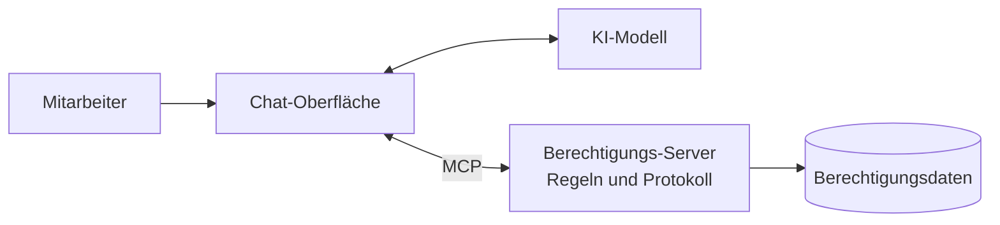

<div align="center">

# SAP-Berechtigungsassistent

### Berechtigungsfragen in Sekunden klären. Ohne Ticket. Mit Beleg.

**Ein KI-Assistent für SAP-Berechtigungen, der erklärt, statt zu raten.<br>Konflikte prüft feste Regellogik, jeder Zugriff wird protokolliert.**


[Problem](#das-problem) · [Lösung](#die-lösung) · [Mehrwert](#mehrwert-für-ihr-unternehmen) · [Sicherheit](#sicher-by-design) · [Demo](#demo) · [Fahrplan](#vom-prototyp-zum-einsatz)

</div>

---


## Das Problem

- **Fachbereiche verstehen SAP-Berechtigungen nicht.** "Warum kann ich keinen Zahllauf starten?" wird zum Ticket an das Berechtigungsteam.
- **Berechtigungsteams beantworten immer wieder dieselben Fragen,** statt sich um Konzept und Risiken zu kümmern.
- **SoD-Berichte bleiben unverstanden.** Verantwortliche sehen Konfliktlisten, wissen aber nicht, was sie bedeuten und was zu tun ist.
- **KI-Assistenten kommen, die Kontrolle fehlt.** Was sieht die KI, woher stammen ihre Aussagen, wer hat was gefragt?

## Die Lösung

Ein Assistent, den jeder Mitarbeiter in normaler Sprache fragen kann. Er greift über eine kontrollierte Schnittstelle auf die Berechtigungsdaten zu, prüft mit festen Regeln und erklärt das Ergebnis verständlich.

| Heute | Mit dem Assistenten |
| --- | --- |
| Ticket schreiben und auf Antwort warten | Frage stellen, Antwort in Sekunden |
| Experte sucht Rollen, Transaktionen und Regeln zusammen | Der Assistent erledigt das über definierte Werkzeuge |
| Technische Antwort, die der Fachbereich nicht versteht | Verständliche Erklärung mit Lösungsvorschlag |
| Kein Nachweis, wer was gefragt hat | Jeder Zugriff wird protokolliert |

## Was er kann

| | Fähigkeit | Beispiel |
| --- | --- | --- |
| 👤 | **Berechtigungen auskunften** | "Welche Rollen hat Anna Weber?" |
| ⚖️ | **SoD-Konflikte prüfen** | "Hat MMUSTER Konflikte in der Funktionstrennung?" |
| 💡 | **Verständlich erklären** | Warum Kreditor anlegen und Zahllauf zusammen ein Risiko sind |
| 🛠️ | **Lösungen vorschlagen** | Welche Rolle entzogen oder aufgeteilt werden sollte |
| 🔍 | **Vergleichen** | "Vergleiche LKRAUSE und TSCHMIDT." |

## Mehrwert für Ihr Unternehmen

| Für | Nutzen |
| --- | --- |
| **Berechtigungsteam** | Weniger Routineanfragen, mehr Zeit für Konzept und Risikoarbeit |
| **Fachbereiche** | Sofortige, verständliche Auskunft statt Wartezeit |
| **Revision und Compliance** | Prüfungen nach festen Regeln, jeder Zugriff nachvollziehbar |
| **IT-Security** | Die KI arbeitet nur über freigegebene, lesende Werkzeuge |

## Sicher by Design

Der Assistent ist von Grund auf für sensible Berechtigungsdaten gebaut:

- **Kein freier Datenzugriff:** Die KI nutzt nur freigegebene Werkzeuge
- **Nur lesend:** Nichts wird geändert, keine Berechtigung vergeben
- **Regeln statt Vermutungen:** Ob ein Konflikt vorliegt, entscheidet fester Code. Gleiche Daten, gleiches Ergebnis
- **Mensch entscheidet:** Die KI erklärt und schlägt vor, Freigaben bleiben beim Menschen
- **Lückenlos protokolliert:** Jeder Werkzeugaufruf mit Zeit und Eingabe
- **Datensparsam:** Die KI erhält nur das Ergebnis zur aktuellen Frage, nie den gesamten Berechtigungsbestand

## Demo

Jede Antwort zeigt die zugrunde liegenden Prüfungen. Ein Klick auf "Werkzeugaufrufe" macht sichtbar, worauf die Aussage beruht (Screenshot oben).

Der Assistent nutzt den offenen Standard **MCP** (Model Context Protocol). Dieselben Werkzeuge funktionieren in der eigenen Oberfläche, in Claude Desktop und in anderen MCP-fähigen Agenten:


## So funktioniert es



Die KI formuliert, der Berechtigungs-Server prüft. Die Datenquelle ist austauschbar: heute Musterdaten, im Einsatz Ihr SAP-System.

## Vom Prototyp zum Einsatz

| Phase | Inhalt | Stand |
| --- | --- | --- |
| **1. Proof of Concept** | Auskunft, SoD-Prüfung, Erklärung, Protokoll, eigene Oberfläche | ✅ Fertig |
| **2. Pilot** | Ihr SoD-Regelwerk und ein Berechtigungsexport aus Ihrem System, weitere Prüfungen wie inaktive Benutzer und kritische Transaktionen | Nächster Schritt |
| **3. Integration** | Live-Anbindung an SAP, Betrieb auf SAP BTP mit Anmeldung, Protokoll mit Benutzerbezug | Geplant |
| **4. Ausbau** | Einbindung in Joule-Agenten, lokales Sprachmodell, Prüfung auf Ebene von Berechtigungsobjekten | Geplant |

---

<details>
<summary><b>Installation und Bedienung</b></summary>

Voraussetzungen: Python 3.13, Git, API-Key aus der [Anthropic Console](https://console.anthropic.com)

```powershell
git clone https://github.com/oemer-systems/sap-auth-mcp.git
cd sap-auth-mcp
py -3.13 -m venv .venv
.venv\Scripts\activate
pip install -r requirements.txt
$env:ANTHROPIC_API_KEY="dein-key"
```

| Nutzung | Befehl |
| --- | --- |
| Chat im Browser | `streamlit run app.py` |
| Chat im Terminal | `python chat.py` |
| Werkzeug direkt, ohne KI | `python -c "from server import sod_pruefen; print(sod_pruefen('MMUSTER'))"` |
| MCP Inspector (Node.js) | `npx @modelcontextprotocol/inspector python server.py` |

**Claude Desktop:** Eintrag in `claude_desktop_config.json` unter `mcpServers`:

```json
"sap-auth": {
  "command": "C:\\Pfad\\zu\\sap-auth-mcp\\.venv\\Scripts\\python.exe",
  "args": ["C:\\Pfad\\zu\\sap-auth-mcp\\server.py"]
}
```

</details>

<details>
<summary><b>Technik und Aufbau</b></summary>

Python · MCP Python SDK 2.x · Claude API · Streamlit

| Datei | Aufgabe |
| --- | --- |
| `server.py` | MCP-Server mit den Werkzeugen `benutzer_rollen` und `sod_pruefen`, Regellogik und Protokoll |
| `agent.py` | Agenten-Schleife: Werkzeuge abfragen, Modell befragen, Aufrufe ausführen |
| `app.py` | Chat-Oberfläche im Browser |
| `chat.py` | Chat im Terminal |
| `data/` | Musterdaten: Benutzer, Rollen, Zuordnungen, Transaktionen, SoD-Regeln |

**Erkenntnisse aus der Entwicklung**

- Die Werkzeugbeschreibung steuert die KI: Name und Docstring sind alles, was das Modell über ein Werkzeug erfährt
- Das Modell führt nichts selbst aus. Es fordert einen Werkzeugaufruf an, der eigene Code entscheidet
- Ein stdio-Server darf nichts auf die Standardausgabe schreiben, deshalb protokolliert er in eine Datei
- Im MCP SDK 2.x heißt `FastMCP` jetzt `MCPServer`, ältere Beispiele müssen angepasst werden

</details>

<details>
<summary><b>Musterdaten und eingebaute Befunde</b></summary>

| Benutzer | Befund |
| --- | --- |
| MMUSTER | Kreditor anlegen und Zahllauf ausführen (SOD01, SOD02, SOD03) |
| AWEBER | Bestellung anlegen, selbst freigeben und Wareneingang buchen (SOD04, SOD05) |
| LKRAUSE | Auftrag anlegen und Kreditlimit ändern (SOD06) |
| JBECKER | Rollen pflegen und zuweisen (SOD07), zusätzlich Entwicklerrechte |
| NWOLF | Gesperrt, Rollen aber noch zugeordnet |
| DSCHULZ | Seit Februar 2025 inaktiv, Rollen noch zugeordnet |
| FIREFIGHTER_01 | Notfallbenutzer mit dauerhaften Entwicklerrechten |

Die SoD-Konflikte erkennt der Assistent bereits. Die übrigen Befunde sind für die Prüfungen aus Phase 2 vorbereitet.

</details>

<details>
<summary><b>Stand des Proof of Concept</b></summary>

- Frei erfundene Musterdaten, noch keine Anbindung an ein SAP-System
- Transaktionscodes nach SAP ECC, in S/4HANA erfolgt die Kreditorenpflege über die Transaktion BP
- SoD-Prüfung auf Transaktionsebene, noch nicht auf Ebene von Berechtigungsobjekten
- Protokoll ohne Benutzerbezug, das folgt mit Anmeldung in Phase 3
- Fragen und Werkzeugergebnisse gehen an die Claude API

</details>

---

<div align="center">

**Interesse an einer Vorführung oder einem Pilot mit Ihrem Regelwerk?**

[github.com/oemer-systems](https://github.com/oemer-systems)

<sub>Proof of Concept mit frei erfundenen Musterdaten. Entwickelt mit KI-Unterstützung.</sub>

</div>
